# DAM Metadata Agent

A production-oriented proof of concept for **digital asset metadata management** with
**Java 21, Spring Boot 4, LangChain4j and LangChain4j Agentic**.

Binaries stay in the enterprise DAM; this service manages the *metadata* about them: a configurable schema,
deterministic validation, taxonomy classification, AI-assisted extraction and enrichment, human approval, an
immutable audit trail, quality scoring, hybrid (structured + vector) search, duplicate detection and RAG over
metadata-governance documentation.

> **Agents reason. Spring services execute. The domain remains authoritative.**
> LLMs only *propose*; deterministic Java decides what is applied, and humans approve sensitive changes.

It ships with **AI Metadata DAM**, an enterprise web UI (React + TypeScript) for metadata review, live agentic
workflow visualisation, human approval, semantic search, taxonomy and audit - see [Web UI](#web-ui).

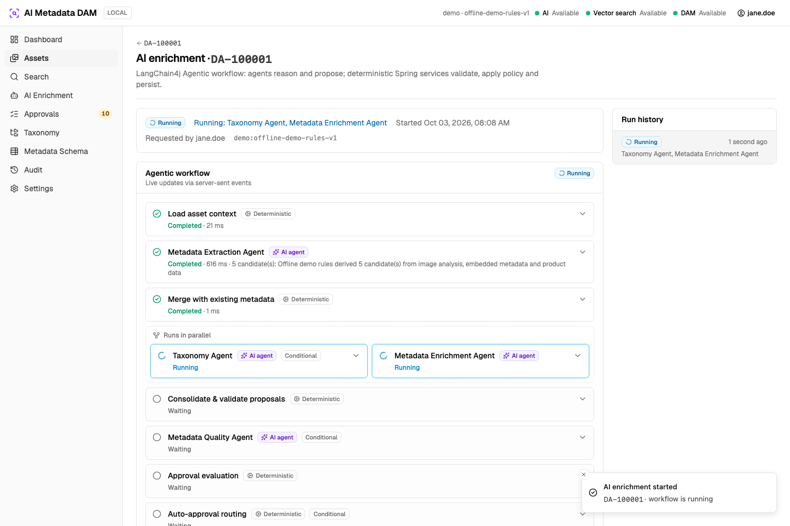

---

## Contents

1. [Quick start](#quick-start)
2. [Architecture](#architecture)
3. [Web UI](#web-ui)
4. [Metadata model and schema](#metadata-model-and-schema)
5. [Agents](#agents)
6. [Agentic enrichment workflow](#agentic-enrichment-workflow)
7. [Human approval and confidence thresholds](#human-approval-and-confidence-thresholds)
8. [RAG](#rag)
9. [Search](#search)
10. [Walkthrough with curl](#walkthrough-with-curl)
11. [Configuring the LLM provider](#configuring-the-llm-provider)
12. [Observability and resilience](#observability-and-resilience)
13. [Testing](#testing)
14. [API overview](#api-overview)
15. [Project layout](#project-layout)

Design decisions are explained in [docs/architecture.md](docs/architecture.md).

---

## Quick start

**Prerequisites:** JDK 21 or newer (the build targets Java 21), Docker or Podman with Compose, Node.js 22.22 or
newer for the web UI, `curl` (and `jq` for the walkthrough). Maven is provided by the wrapper.

```bash
docker compose up -d          # PostgreSQL 17 + pgvector on localhost:5433
./mvnw spring-boot:run        # API on http://localhost:8080

# in a second terminal
cd frontend && npm install && npm run dev     # web UI on http://localhost:5173
```

That's all - no API key required. By default `AI_PROVIDER=demo` selects an **offline, deterministic demo model**
(see [below](#the-offline-demo-model)) so the complete LangChain4j Agentic workflow runs out of the box.
Embeddings are computed in-process (all-MiniLM-L6-v2), so semantic search and RAG work offline too.

On startup the application migrates the schema (Flyway), synchronises the metadata schema from YAML, ingests the
knowledge base into pgvector and registers 16 sample assets (the mock DAM renders simple preview images for them).

| URL | |
|---|---|
| http://localhost:5173 | Web UI (development server; `./mvnw -Pfrontend package` serves it from :8080 instead) |
| http://localhost:8080/swagger-ui.html | OpenAPI / Swagger UI |
| http://localhost:8080/actuator/health | Health (incl. AI configuration) |
| http://localhost:8080/actuator/prometheus | Metrics |

`docker compose down -v` resets the database. The database port can be changed with `DAM_DB_PORT` (see
[.env.example](.env.example)).

---

## Architecture

Hexagonal / clean architecture, organised by module. Domain code has no framework or LangChain4j dependencies;
LangChain4j lives exclusively in `com.example.dam.ai` and is reached only through application-layer ports.

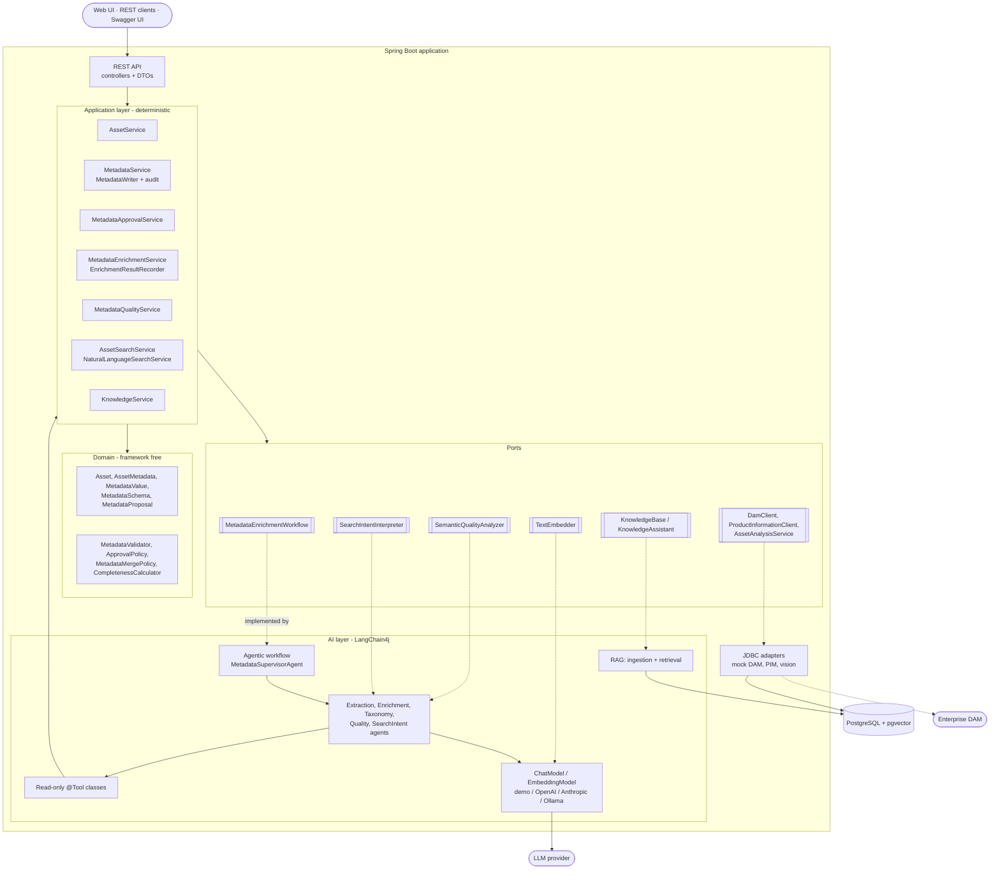

| Module | Responsibility |
|---|---|
| `asset` | Asset references (external id, URL, type, status), registration, DAM port |
| `metadata` | Schema, typed values, validation, completeness, proposals, approval and review policy, enrichment orchestration and run tracking, catalog read model, dashboard |
| `taxonomy` | Hierarchical taxonomy and deterministic keyword search |
| `audit` | Append-only metadata audit log |
| `search` | Hybrid search, NL search translation, indexing, duplicates, recommendations |
| `knowledge` | Ports and API for the governance knowledge base |
| `system` | Capability status for the UI: AI, vector search, DAM, governance thresholds |
| `ai` | LangChain4j: model configuration, agents, tools, RAG, agentic workflow, observability, demo model |
| `common` | Errors (RFC 9457 problem details), correlation ids, actor resolution, configuration |

---

## Web UI

`frontend/` contains **AI Metadata DAM**, a web UI designed around DAM metadata workflows rather than a generic
admin dashboard or a chatbot: dense metadata tables, inspector panels, provenance and confidence badges,
side-by-side proposal review and a live view of the agentic workflow.

| | |
|---|---|
| 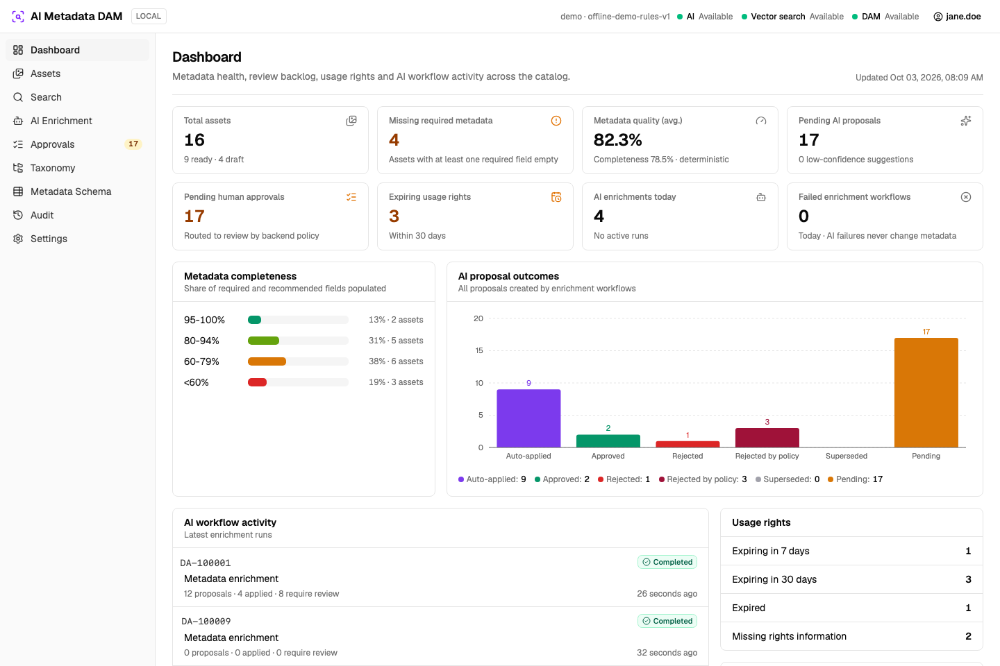 | 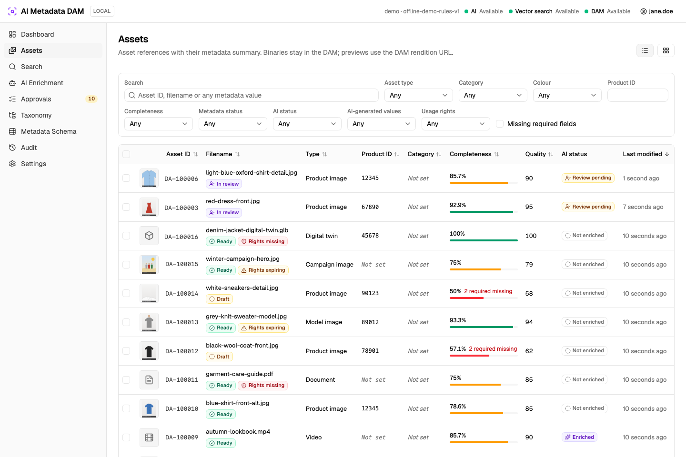 |
| **Dashboard** - catalog health, review backlog, usage rights, workflow activity | **Assets** - table/grid view, filters, sorting, completeness, quality, AI status, bulk actions |
| 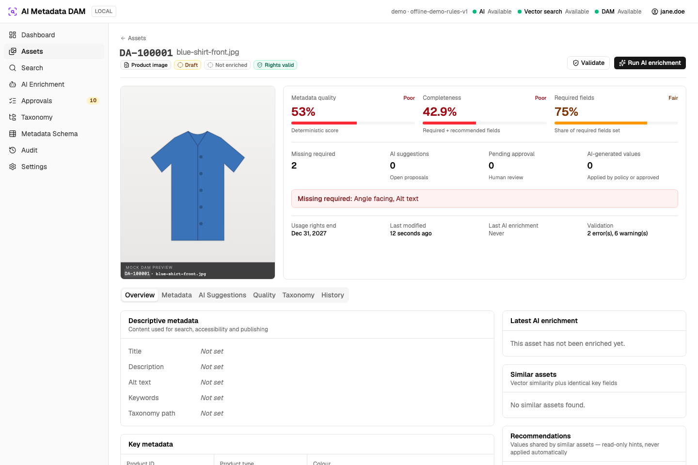 |  |
| **Asset detail** - preview, deterministic quality summary, Overview / Metadata / AI Suggestions / Quality / Taxonomy / History | **AI enrichment** - real stage status pushed by the backend over SSE |
| 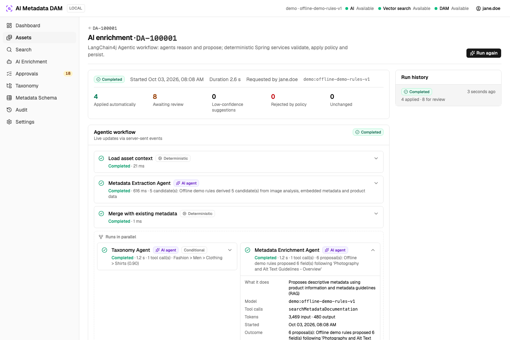 | 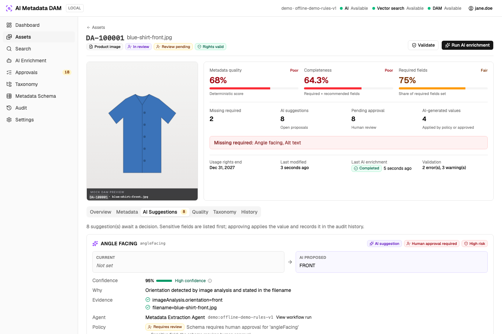 |
| **Stage details** - model, tool calls, tokens, safe outcome summary | **AI suggestions** - current vs. proposed, confidence, evidence, agent and backend policy |
| 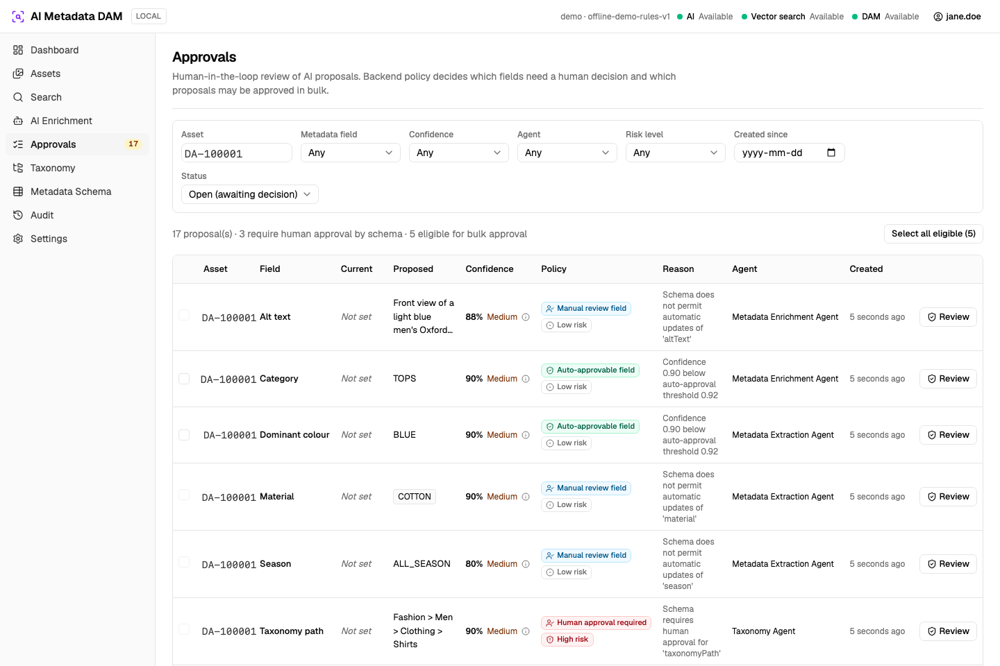 | 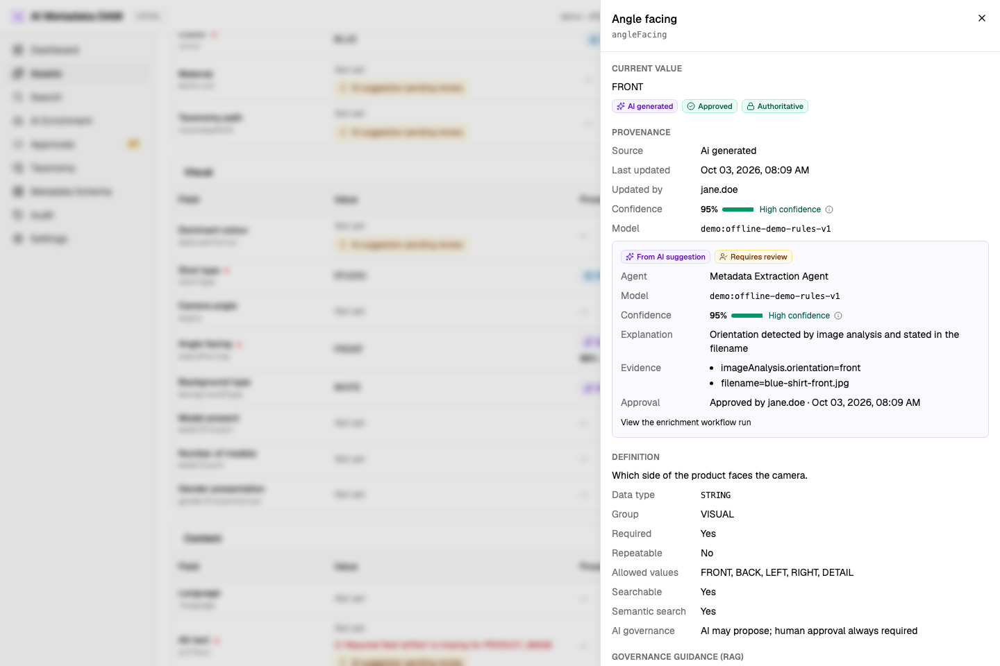 |
| **Approvals** - filterable review queue; bulk approval only where the backend allows it | **Metadata editor** - grouped fields with provenance; inspector with definition and AI origin |
| 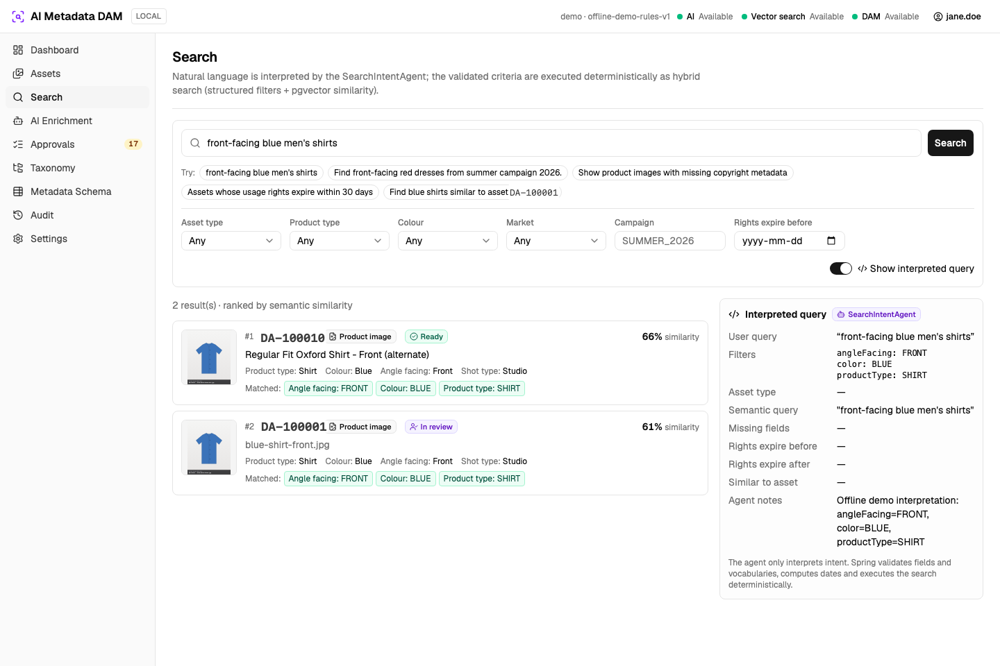 | 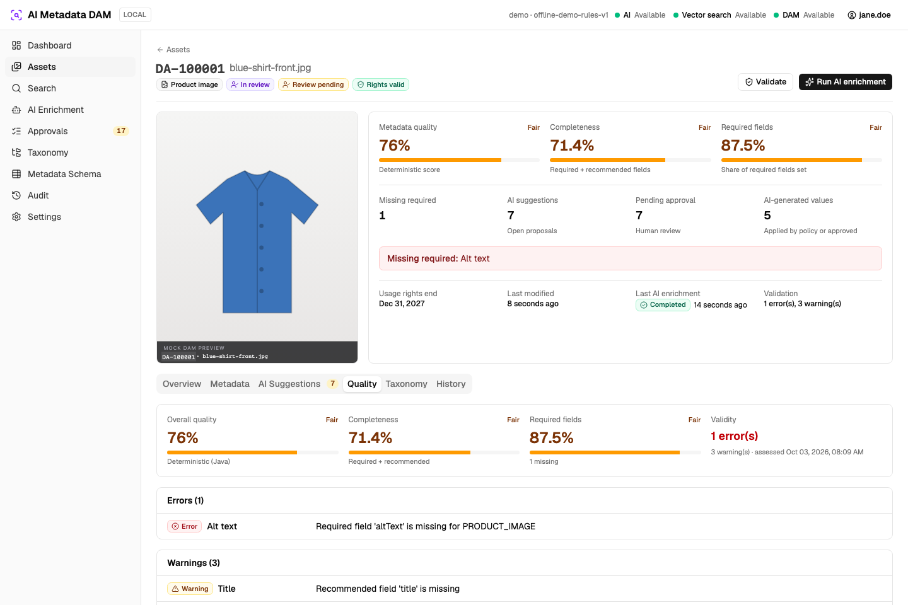 |
| **Search** - natural language plus filters, with the SearchIntentAgent's interpretation | **Quality** - scores, then errors, warnings and suggestions by severity |
| 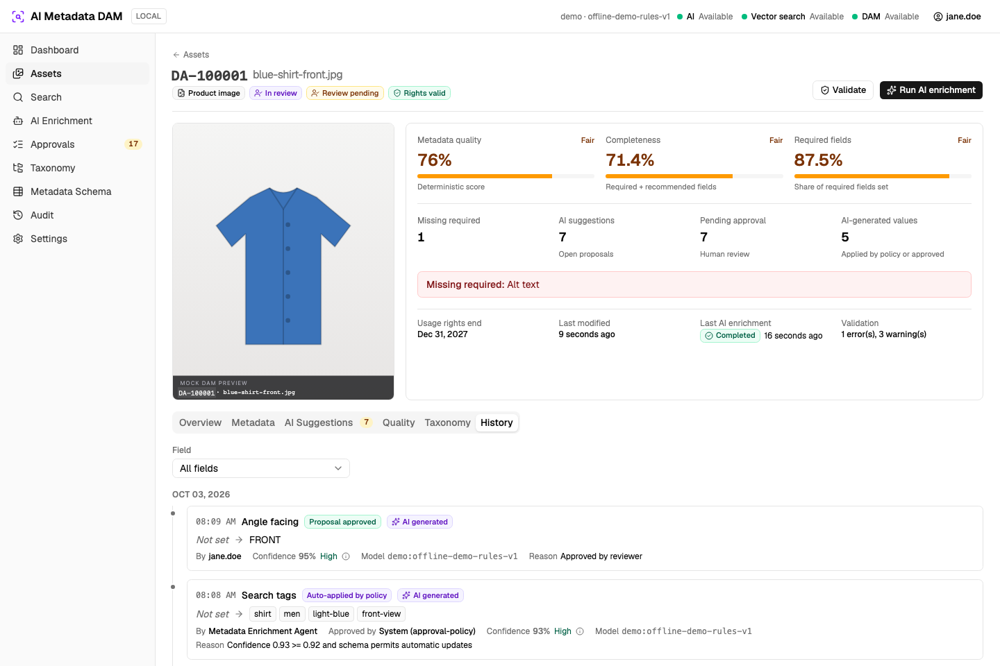 | 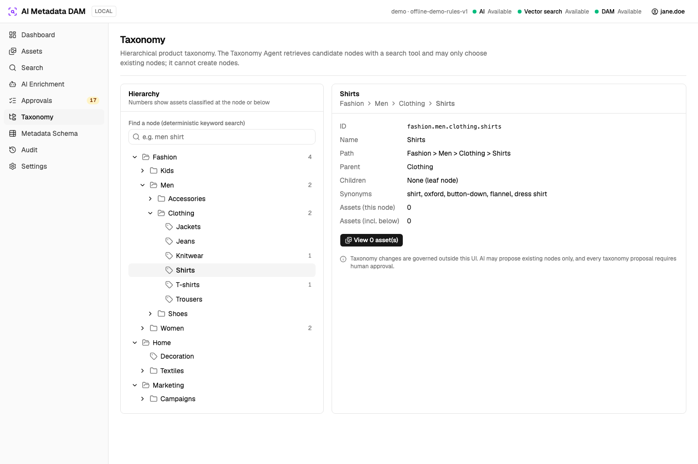 |
| **History** - audit timeline per asset | **Taxonomy** - hierarchy with asset counts per node |
| 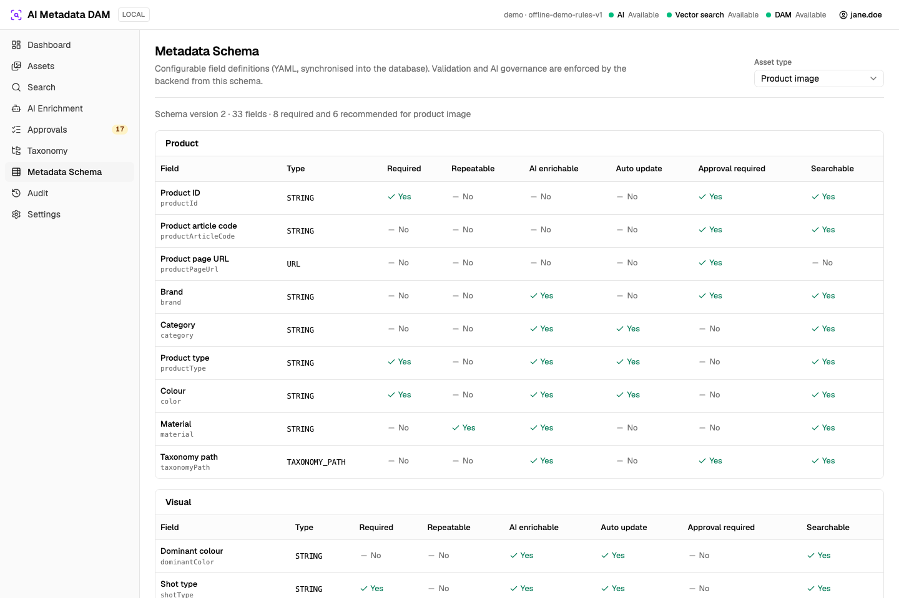 | 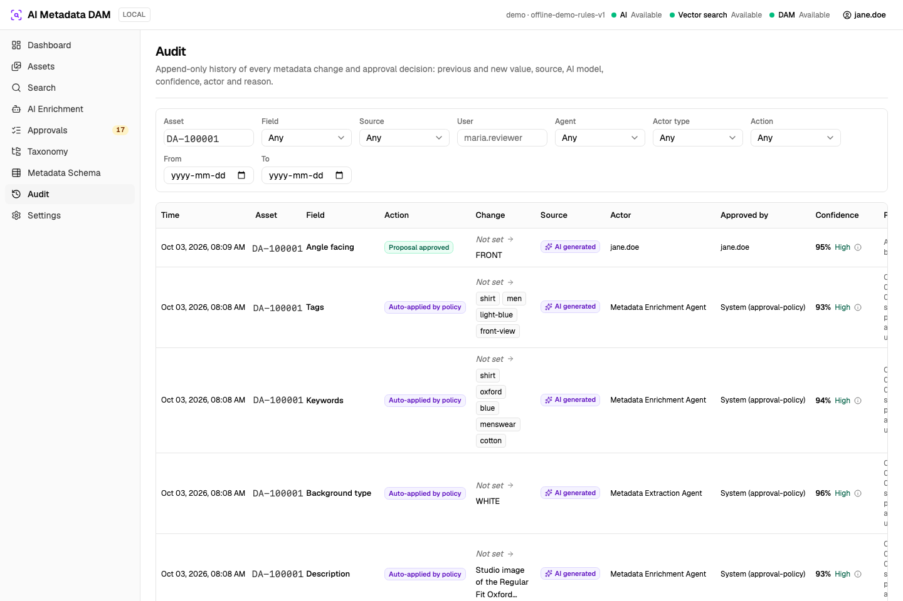 |
| **Metadata schema** - field definitions and AI policy per asset type | **Audit** - global, filterable change log |

### Running the UI

**Development** - the Vite dev server (hot reload) proxies `/api`, `/actuator`, `/mock-dam`, `/swagger-ui` and
`/v3` to the backend (`DAM_BACKEND_URL`, default `http://localhost:8080`). Requires Node.js 22.22 or newer.

```bash
./mvnw spring-boot:run            # backend on :8080

# in a second terminal
cd frontend
npm install
npm run dev                       # http://localhost:5173
```

**Production** - one deployable. The `frontend` Maven profile installs Node into `target/`, runs `npm ci` and
`npm run build`, and bundles `frontend/dist` into the jar. Spring Boot serves it from `classpath:/static` and answers
client-side routes such as `/assets/{id}` with `index.html` (`SpaWebConfiguration`); `/api/**`, `/actuator/**` and
missing static files still return real 404s.

```bash
./mvnw -Pfrontend package
java -jar target/metadata-agent-0.1.0-SNAPSHOT.jar     # UI and API on http://localhost:8080
```

Alternatively, serve `frontend/dist` from any static web server or CDN and route `/api` to the backend on the same
origin. Behind a TLS-intercepting corporate proxy, give Maven a truststore containing the proxy's CA
(`MAVEN_OPTS="-Djavax.net.ssl.trustStore=..."`) so the profile can download Node.

| Script (in `frontend/`) | |
|---|---|
| `npm run dev` | development server with API proxy |
| `npm run build` | type check and production build into `dist/` |
| `npm test` | Vitest + React Testing Library |
| `npm run lint`, `npm run typecheck` | ESLint, TypeScript |

### Frontend architecture

React 19, TypeScript, Vite, Tailwind CSS, shadcn/ui (Radix), TanStack Query, React Router, React Hook Form + Zod,
Lucide icons, Recharts and Sonner toasts.

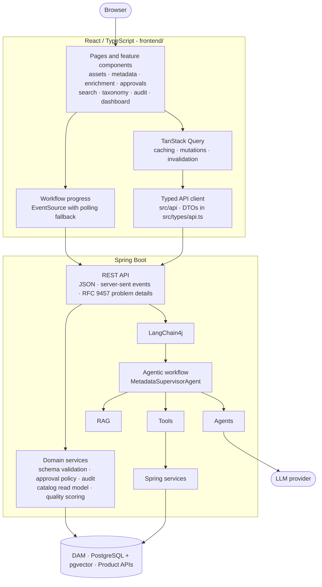

The browser never talks to an LLM provider: every model call goes through Spring and LangChain4j, and API keys exist
only in the backend's environment.

```
frontend/src
├── api/          typed client (fetch, problem details), one module per backend area, query keys
├── types/        DTOs mirroring the backend's OpenAPI schemas
├── components/   shared UI: source/status badges, ConfidenceIndicator, ScoreMeter, AssetPreview, states; ui/ = shadcn
├── features/     assets · metadata · enrichment · approvals · search · taxonomy · audit · dashboard
├── hooks/        system status, current user, debouncing
├── layouts/      AppLayout: top bar with capability status, collapsible sidebar
├── pages/        route components (lazy-loaded per route)
├── routes/       React Router configuration
├── utils/        formatting, confidence bands, downloads
└── test/         Vitest + Testing Library + MSW harness and scenario tests
```

| Route | |
|---|---|
| `/` | Dashboard: KPIs, completeness distribution, proposal outcomes, workflow activity, usage rights |
| `/assets` | Catalog in table or grid view; filters, sorting, pagination, multi-select; bulk validate / enrich / export |
| `/assets/:assetId` | Asset detail with tabs Overview, Metadata (editor + inspector), AI Suggestions, Quality, Taxonomy, History |
| `/assets/:assetId/enrich` | Live agentic workflow for one asset, run history, proposals of the run |
| `/search` | Natural-language + structured search, optional interpreted-query panel |
| `/enrichment` | Enrichment runs across the catalog |
| `/approvals` | Human-in-the-loop review queue |
| `/taxonomy`, `/metadata-schema`, `/audit` | Taxonomy browser (assets per node), schema viewer per asset type, global audit log |
| `/settings` | Reviewer identity (`X-User-Id`) and the backend configuration in use (read-only) |

UI principles:

* **The backend decides, the UI renders.** Approval policy (`policy.requiresHumanApproval`, `canAutoApprove`,
  `bulkApprovable`, `riskLevel`, `riskFactors`), field definitions (`allowedValues`, `required`, `ai.enrichable`,
  `ai.autoApply`, `ai.humanApprovalRequired`), validation issues, completeness and quality scores and the confidence
  thresholds (`/api/system/status`) all come from the API. Zod checks in forms are derived from the backend field
  definition for immediate feedback only; the backend validates again and its issues are shown in the form.
* **Provenance is first-class.** Every value shows its source (`MANUAL`, `DAM`, `PRODUCT_SYSTEM`, `EMBEDDED`,
  `DERIVED`, `AI_GENERATED`) and status; values that came from an AI proposal also show agent, model, confidence,
  evidence and approval state (`origin` in the metadata response), including values a reviewer edited.
* **AI is never presented as authoritative.** The wording is "AI suggestion", "Proposed", "Requires review".
  Confidence is always a percentage plus a band label, with the note *"Confidence is generated by the AI workflow and
  should not be interpreted as guaranteed accuracy."* Hidden model reasoning is never shown - only the agent's
  explanation, its evidence and a safe outcome summary.
* **Degrades gracefully.** The top bar shows AI, vector search and DAM availability. Without AI, enrichment actions
  are disabled with an explanation while viewing, editing, validating and approving keep working; without vector
  search, structured search remains. Errors show the problem-detail message (e.g. *"usageRightsEnd requires human
  approval"*), never stack traces.
* **Calm feedback.** Skeleton loaders instead of blocking spinners; toasts only for user actions (saved, approved,
  rejected, enrichment started, errors) - agent steps are shown in the workflow view, not as notifications.
* **Accessible and responsive.** Landmarks and headings, labelled controls, keyboard-operable tree, tables and
  dialogs, visible focus, `aria-live` workflow progress; status, confidence, quality and errors always carry text,
  never colour alone. Desktop first; on tablets the sidebar collapses and panels stack.

### API integration

* `src/api/client.ts` wraps `fetch`: JSON bodies, query strings, the reviewer identity header `X-User-Id` (the
  profile menu is a stand-in for SSO) and RFC 9457 problem details mapped to `ApiError` (stable `code`, `detail`,
  field issues, `correlationId`).
* One module per backend area: `assets.ts`, `metadata.ts`, `enrichment.ts`, `search.ts`, `taxonomy.ts`,
  `approvals.ts`, `audit.ts`, `dashboard.ts`, `system.ts`, `knowledge.ts`.
* DTOs in `src/types/api.ts` mirror the OpenAPI schemas (`/v3/api-docs`). They are maintained by hand in this POC;
  a production pipeline would generate them from the OpenAPI document (e.g. `openapi-typescript`) to detect drift.
* TanStack Query keys follow backend resources; mutations invalidate what they affect (approving a proposal
  refreshes the asset, its metadata, quality, history, the queue, the catalog and the dashboard).

| Query key | Backend resource |
|---|---|
| `["assets", params]` | `GET /api/catalog/assets` |
| `["asset", assetId]` | `GET /api/catalog/assets/{id}` |
| `["metadata", assetId]` | `GET /api/assets/{id}/metadata` |
| `["proposals", params]` | `GET /api/metadata/proposals` |
| `["quality", assetId, includeAi]` | `GET /api/assets/{id}/quality` |
| `["workflow", workflowId]` | `GET /api/workflows/{id}` and `/events` (SSE) |
| `["workflows", params]` | `GET /api/workflows` |
| `["history", assetId, field]`, `["audit", params]` | `GET /api/assets/{id}/metadata/history`, `GET /api/audit/events` |

### Agent workflow visualisation

"Run AI enrichment" starts the workflow asynchronously and opens `/assets/{id}/enrich`, which shows the real stage
status reported by the backend - no simulated progress.

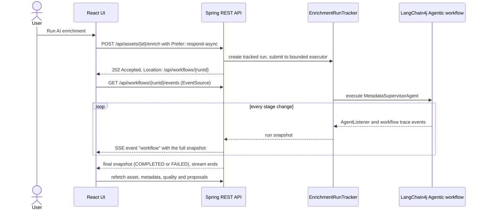

* Stages come from the workflow definition (`GET /api/workflows/plan`): deterministic steps and AI agents, the
  parallel group (Taxonomy and Enrichment agents) and conditional stages, each `WAITING`, `RUNNING`, `COMPLETED`,
  `FAILED` or `SKIPPED`.
* Expanding a stage shows duration, model, tool calls (e.g. `searchTaxonomy`, `searchMetadataDocumentation`), token
  usage, retry attempts and a safe outcome summary.
* Runs and their per-stage results are persisted (`enrichment_runs`), so run history and the dashboard survive
  restarts. If server-sent events are unavailable, the UI polls `GET /api/workflows/{id}` every second until the run
  ends.
* The completed run summarises what was applied automatically, what awaits review, low-confidence suggestions,
  values rejected by policy and unchanged values, and lists the run's proposals for review.

### Approval flow

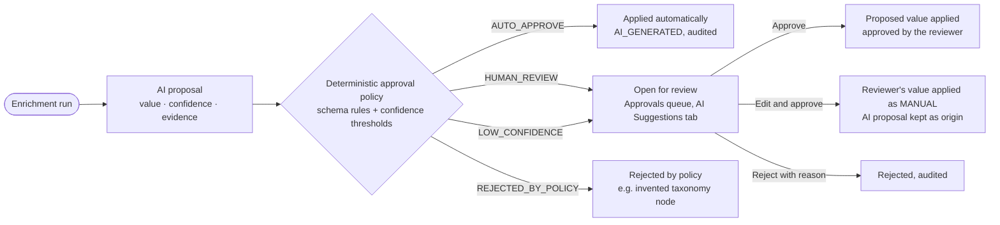

Each review card answers: what exists, what the AI proposes, why, where the evidence came from, how confident the
workflow is and whether human approval is required (backend policy and risk level). Long text fields (title,
description, alt text) are compared side by side:

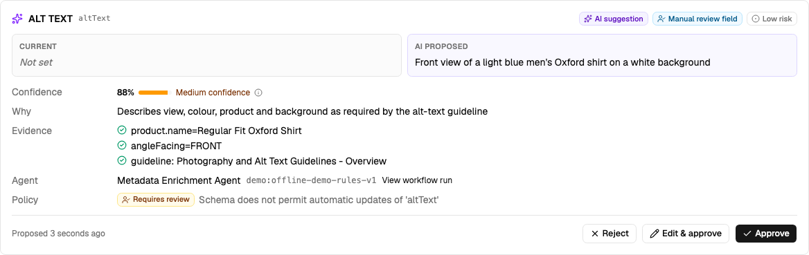

Bulk approval is offered only for proposals the backend marks `bulkApprovable`: open proposals for fields the schema
allows to update automatically, with low risk (no existing value replaced, confidence not below the review
threshold). `POST /api/metadata/proposals/bulk-approve` re-checks the policy and skips everything else. Every decision
requires an identified reviewer and is written to the audit log.

### Semantic search flow

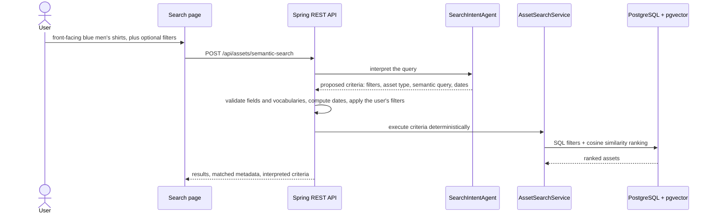

Filters chosen in the UI are merged into the interpreted criteria and take precedence. Results show similarity,
matching metadata and taxonomy; "Show interpreted query" displays exactly what the SearchIntentAgent produced and
what Java executed. Without AI the raw query is ranked semantically; without vector search, structured filters still
work.

---

## Metadata model and schema

**Metadata is not a `Map<String, Object>`.** Values are typed (`MetadataValue`: text, number, boolean, date or a
list of scalars) and every stored value carries provenance:

| `AssetMetadata` | |
|---|---|
| `assetId`, `fieldKey`, `value` | the value (typed) |
| `source` | `MANUAL`, `EMBEDDED`, `AI_GENERATED`, `PRODUCT_SYSTEM`, `DAM`, `DERIVED` |
| `status` | `APPROVED` (human-confirmed or system of record - *authoritative*) or `VALIDATED` (machine-applied after validation) |
| `confidence`, `aiModel` | for machine-generated values |
| `createdAt`, `updatedAt`, `updatedBy` | |

`MetadataStatus` = `PROPOSED | APPROVED | REJECTED | VALIDATED`; proposals use `PROPOSED/APPROVED/REJECTED`,
stored values `APPROVED/VALIDATED`. AI-generated metadata is therefore always distinguishable from authoritative
metadata.

### Configurable schema

The schema is configuration, not code: [`metadata-schema/dam-metadata-schema.yaml`](src/main/resources/metadata-schema/dam-metadata-schema.yaml)
is synchronised into `metadata_field_definitions`, `metadata_asset_type_requirements` and
`metadata_cross_field_rules` at startup. Example:

```yaml
angleFacing:
  displayName: Angle facing
  type: STRING
  searchable: true
  semanticSearch: true
  allowedValues: [FRONT, BACK, LEFT, RIGHT, DETAIL]
  ai: { enrichable: true, autoApply: false, humanApprovalRequired: true }

usageRightsEnd:
  type: DATE
  searchable: true
  ai: { enrichable: false }      # AI may not even propose it

assetTypes:
  PRODUCT_IMAGE:
    required: [productId, productType, color, angleFacing, shotType, copyrightOwner, usageRightsEnd, altText]
    recommended: [title, keywords, taxonomyPath, backgroundType, material, description]

rules:
  - { id: usage-rights-period, type: DATE_RANGE, startField: usageRightsStart, endField: usageRightsEnd }
  - { id: usage-rights-expiry, type: RIGHTS_EXPIRY, field: usageRightsEnd, warningWindowDays: 30 }
  - { id: ab-test-requires-experiment, type: CONDITIONAL_REQUIRED, whenField: intendedForABTest, whenValue: "true", requiredField: experimentIdentifier }
```

Per field: data type (`STRING, TEXT, INTEGER, DECIMAL, BOOLEAN, DATE, URL, TAXONOMY_PATH`), required/recommended
per asset type, repeatable, controlled vocabulary, validation (`pattern, minLength, maxLength, minValue, maxValue,
maxItems`), searchable, semantic-search participation and the AI policy (`enrichable`, `autoApply`,
`humanApprovalRequired`). `GET /api/metadata/schema/{assetType}` returns the effective schema.

### Deterministic validation

`MetadataValidator` (pure Java, no LLM) detects missing required fields, invalid data types, values outside a
vocabulary, pattern/length/range violations, expired rights (error) and rights expiring within 30 days (warning),
invalid date ranges, unsupported keys, duplicate values, malformed URLs, unknown taxonomy paths and conditional
requirements. Completeness and the 0-100 quality score are computed in Java as well. The asset status
(`DRAFT`, `IN_REVIEW`, `READY`) is derived from validity and open review work after every change.

---

## Agents

Narrow agents, one responsibility each. Prompts live in [`src/main/resources/prompts`](src/main/resources/prompts)
(ROLE / GOAL / AVAILABLE INFORMATION / AVAILABLE TOOLS / CONSTRAINTS / EXPECTED OUTPUT, plus shared critical rules
such as *"never invent metadata values merely to fill missing fields"*). All outputs are **structured** Java records
(JSON-schema structured outputs when the provider supports them).

| Agent | Purpose | Tools (read-only) | Output |
|---|---|---|---|
| `MetadataExtractionAgent` | Extract values directly supported by filename, EXIF/XMP, vision analysis and product data | `getProductInformation` | `ExtractionOutput` |
| `MetadataEnrichmentAgent` | Propose title, alt text, description, keywords, tags, category | `searchMetadataDocumentation`, `getAsset`, `searchAssets` | `EnrichmentOutput` |
| `TaxonomyAgent` | Map to an **existing** taxonomy node retrieved via tool | `searchTaxonomy`, `getTaxonomyNode` | `TaxonomyClassification` |
| `MetadataQualityAgent` | Soft quality: weak descriptions, poor alt text, irrelevant keywords, ambiguous classification, inconsistent semantics | `searchMetadataDocumentation`, `getMetadata`, `getMetadataSchema` | `QualityReviewOutput` |
| `SearchIntentAgent` | Natural language -> structured search intent | - | `SearchIntentOutput` |
| `MetadataSupervisorAgent` | Typed entry point that orchestrates the enrichment workflow | (sub-agents) | `MetadataEnrichmentResult` |
| `MetadataKnowledgeAssistant` | RAG question answering (classic AI service) | retrieval augmentor | `KnowledgeAnswerOutput` |

Every suggestion carries `field`, `values`, `confidence`, `explanation` and `evidence`. Tools delegate to Spring
services and expose no write operations; there is no tool that could delete assets or change metadata. Inside the
workflow the agents are LangChain4j Agentic agents; for standalone calls (quality report, search interpretation)
the same interfaces and prompts are built as plain AI Services.

---

## Agentic enrichment workflow

`POST /api/assets/{id}/enrich` runs a LangChain4j Agentic system behind the `MetadataEnrichmentWorkflow` port. It
combines **sequential execution, parallel execution, conditional execution, a shared agentic scope** and a
**supervisor/orchestrator** at the root. Deterministic steps are plain `@Agent` POJOs that participate in the same
agentic system.

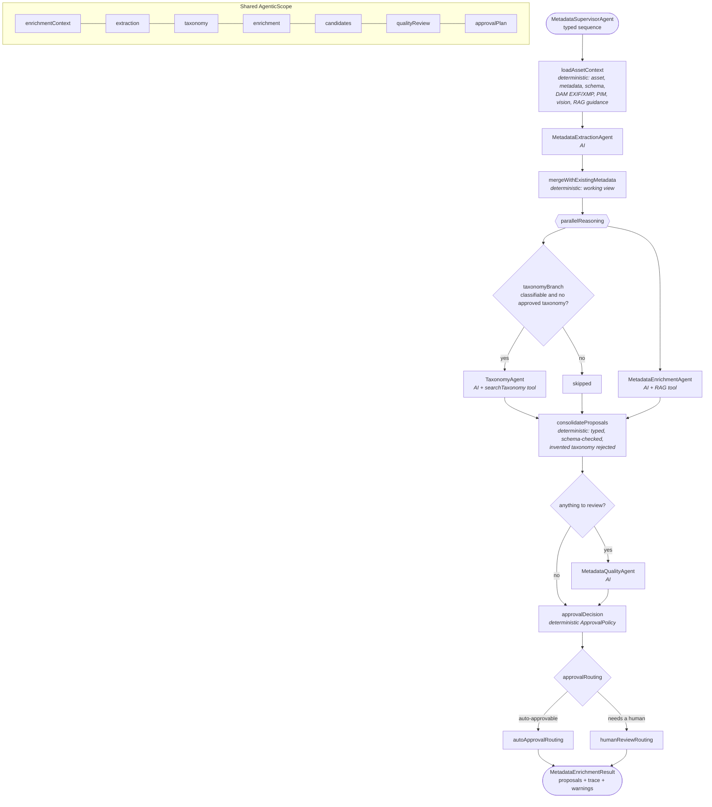

The workflow **returns proposals only**. Persistence happens afterwards in the application layer, in one
transaction, where every candidate is re-evaluated against the latest stored metadata:

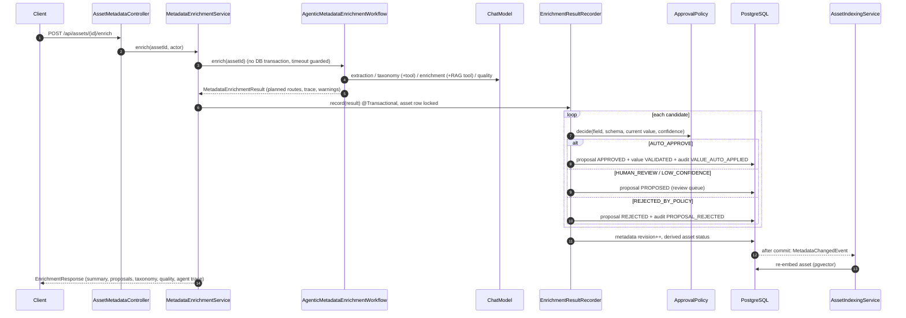

Each response includes the agent trace (agent, kind, outcome, duration, tokens, tool calls).

---

## Human approval and confidence thresholds

```yaml
ai:
  metadata:
    confidence:
      auto-approve: 0.92
      human-review: 0.70
```

The deterministic `ApprovalPolicy` decides, in this order:

1. Unknown field or schema forbids AI values (`enrichable: false`, e.g. usage rights, productId) -> `REJECTED_BY_POLICY`
2. Value fails validation (vocabulary, pattern, unknown taxonomy path, ...) -> `REJECTED_BY_POLICY`
3. Equivalent to the current value -> `NO_CHANGE` (not recorded)
4. Would replace an authoritative (`APPROVED`) value -> `REJECTED_BY_POLICY`
5. Confidence `< 0.70` -> `LOW_CONFIDENCE` suggestion (never applied automatically)
6. `humanApprovalRequired` (taxonomy, copyright, angleFacing, campaign, experimentIdentifier, ...) -> `HUMAN_REVIEW`
7. Would replace an existing machine value, or extend a human-approved list -> `HUMAN_REVIEW`
8. Confidence `>= 0.92` **and** `autoApply` -> `AUTO_APPROVE`; otherwise `HUMAN_REVIEW`

The schema-level safety rule always overrides confidence. Approvals are durable work items, not suspended
in-memory agents:

| Endpoint | |
|---|---|
| `GET /api/metadata/proposals?status=PROPOSED&route=HUMAN_REVIEW&assetId=` | review queue |
| `GET /api/metadata/proposals/{id}` | proposal with confidence, explanation, evidence |
| `POST /api/metadata/proposals/{id}/approve` | applies the value (re-validated, stale-checked) |
| `POST /api/metadata/proposals/{id}/reject` | requires a reason |

Approval requires an identified human (`X-User-Id` header - stand-in for an identity provider); AI and system
actors can never approve. Every decision is audited (`GET /api/assets/{id}/metadata/history`) with previous/new
value, source, AI model, confidence, actor, approver, reason and correlation id. Approved values are written back
to the external DAM after commit.

---

## RAG

Metadata-governance documentation in [`src/main/resources/knowledge`](src/main/resources/knowledge) (field
definitions, governance rules, taxonomy guidelines, naming conventions, usage-rights rules, photography and
alt-text guidelines, examples) is the source of business knowledge for the agents - instead of large hard-coded
rules in prompts.

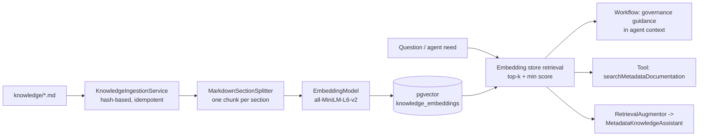

* `GET /api/knowledge/search?q=` - pure retrieval (no LLM)
* `POST /api/knowledge/ask` - grounded answer with sources, `UNKNOWN` when the documentation doesn't cover it

---

## Search

* **Structured** (`POST /api/assets/search`): metadata filters (case-insensitive; "contains" for lists), asset type,
  missing fields, usage-rights expiry window - executed as SQL over JSONB.
* **Hybrid**: add `semanticQuery` and/or `similarToAssetId`; the same SQL ranks the filtered candidates by pgvector
  cosine distance. Asset embeddings are built deterministically from `semanticSearch` fields, e.g.
  `Product image. Product type: shirt. Colour: blue. Angle facing: front. Keywords: shirt, oxford, blue, menswear,
  cotton. Taxonomy path: Fashion > Men > Clothing > Shirts.`
* **Natural language** (`POST /api/assets/semantic-search`): the `SearchIntentAgent` interprets the query; Java
  validates fields/vocabularies, computes dates (e.g. "within 30 days") and executes deterministically. Without AI
  it falls back to semantic ranking of the raw query. Optional `filters`, `assetType` and `rightsExpiryBefore` in
  the request are merged into the interpreted criteria and take precedence (the UI's filter bar uses them).
* `GET /api/assets/{id}/duplicates` - probable duplicates / similar assets (embedding similarity + identical key fields)
* `GET /api/assets/{id}/recommendations` - categorical values shared by similar assets (read-only hints)

---

## Walkthrough with curl

The reference scenario: a `PRODUCT_IMAGE` `blue-shirt-front.jpg` arrives with only `productId=12345`.
(An IntelliJ HTTP-client version is in [http/dam-demo.http](http/dam-demo.http).)

```bash
BASE=http://localhost:8080

# 1. Register the asset reference; filename and URL are resolved from the external DAM
ASSET_ID=$(curl -s -X POST $BASE/api/assets \
  -H 'Content-Type: application/json' -H 'X-User-Id: jane.doe' \
  -d '{"externalAssetId":"DA-200001","type":"PRODUCT_IMAGE","metadata":{"productId":"12345"}}' | jq -r .id)

# 2. View metadata with provenance
curl -s $BASE/api/assets/$ASSET_ID/metadata | jq

# 3. Start the agentic enrichment workflow
curl -s -X POST $BASE/api/assets/$ASSET_ID/enrich -H 'X-User-Id: jane.doe' \
  | jq '.summary, (.proposals[] | {field, value, confidence, route}), (.agentSteps[] | {name, outcome, toolCalls})'
```

Excerpt of the result (demo provider):

```json
{"autoApplied": 7, "pendingReview": 10, "lowConfidenceSuggestions": 0, "rejectedByPolicy": 0, "unchanged": 0}
{"field":"color","value":"BLUE","confidence":0.95,"route":"AUTO_APPROVE"}
{"field":"angleFacing","value":"FRONT","confidence":0.95,"route":"HUMAN_REVIEW"}
{"field":"backgroundType","value":"WHITE","confidence":0.96,"route":"AUTO_APPROVE"}
{"field":"copyrightOwner","value":"Sample Apparel","confidence":0.9,"route":"HUMAN_REVIEW"}
{"field":"title","value":"Regular Fit Oxford Shirt - Front View","confidence":0.9,"route":"HUMAN_REVIEW"}
{"field":"altText","value":"Front view of a light blue men's Oxford shirt on a white background","confidence":0.88,"route":"HUMAN_REVIEW"}
{"field":"keywords","value":["shirt","oxford","blue","menswear","cotton"],"confidence":0.94,"route":"AUTO_APPROVE"}
{"field":"taxonomyPath","value":"Fashion > Men > Clothing > Shirts","confidence":0.9,"route":"HUMAN_REVIEW"}
{"name":"taxonomyAgent","outcome":"SUCCEEDED","toolCalls":["searchTaxonomy"]}
{"name":"metadataEnrichmentAgent","outcome":"SUCCEEDED","toolCalls":["searchMetadataDocumentation"]}
```

```bash
# 4. See the AI proposals waiting for a human
curl -s "$BASE/api/metadata/proposals?assetId=$ASSET_ID&route=HUMAN_REVIEW" \
  | jq '.[] | {id, field, proposedValue, confidence, explanation, evidence, routeReason}'

# 5. Approve a proposal (requires an identified reviewer)
PROPOSAL_ID=$(curl -s "$BASE/api/metadata/proposals?assetId=$ASSET_ID" | jq -r '.[] | select(.field=="angleFacing") | .id')
curl -s -X POST $BASE/api/metadata/proposals/$PROPOSAL_ID/approve \
  -H 'Content-Type: application/json' -H 'X-User-Id: maria.reviewer' \
  -d '{"comment":"Front view confirmed"}' | jq

#    ... or reject one (a reason is mandatory)
TITLE_ID=$(curl -s "$BASE/api/metadata/proposals?assetId=$ASSET_ID" | jq -r '.[] | select(.field=="title") | .id')
curl -s -X POST $BASE/api/metadata/proposals/$TITLE_ID/reject \
  -H 'Content-Type: application/json' -H 'X-User-Id: maria.reviewer' \
  -d '{"reason":"Title convention for this brand differs"}' | jq '{field, status, decisionComment}'

# 6. Set a value manually (validated against the schema, audited)
curl -s -X PUT $BASE/api/assets/$ASSET_ID/metadata/usageRightsEnd \
  -H 'Content-Type: application/json' -H 'X-User-Id: jane.doe' \
  -d '{"value":"2027-12-31","reason":"Licence agreement LA-2026-118"}' | jq

# 7. Deterministic validation (also refreshes the derived asset status)
curl -s -X POST $BASE/api/assets/$ASSET_ID/validate | jq

# 8. Quality report: deterministic score + AI suggestions
curl -s $BASE/api/assets/$ASSET_ID/quality | jq

# 9. Structured + semantic (hybrid) search
curl -s -X POST $BASE/api/assets/search -H 'Content-Type: application/json' \
  -d '{"filters":{"productType":"SHIRT","color":"BLUE"},"semanticQuery":"casual summer menswear"}' | jq

#    deterministic filters only, e.g. product images missing copyright
curl -s -X POST $BASE/api/assets/search -H 'Content-Type: application/json' \
  -d '{"assetType":"PRODUCT_IMAGE","missingFields":["copyrightOwner"]}' | jq '.results[].externalAssetId'

# 10. Natural-language search
curl -s -X POST $BASE/api/assets/semantic-search -H 'Content-Type: application/json' \
  -d '{"query":"front-facing blue men'"'"'s shirts"}' | jq '.interpretedCriteria, (.search.results[] | {externalAssetId, similarity})'

# 11. Audit history
curl -s $BASE/api/assets/$ASSET_ID/metadata/history \
  | jq '.[] | {action, field, previousValue, newValue, actor, approvedBy, aiModel, confidence, reason}'
```

More natural-language queries, RAG and similarity features:

```bash
for q in "Find front-facing red dresses from summer campaign 2026." \
         "Show product images with missing copyright metadata" \
         "Find blue shirts similar to asset DA-100001" \
         "Assets whose usage rights expire within 30 days"; do
  curl -s -X POST $BASE/api/assets/semantic-search -H 'Content-Type: application/json' -d "{\"query\":\"$q\"}" \
    | jq -c '{q: .query, criteria: .interpretedCriteria | {filters, missingFields, assetType, rightsExpiryBefore}, results: [.search.results[].externalAssetId]}'
done

curl -s -X POST $BASE/api/knowledge/ask -H 'Content-Type: application/json' \
  -d '{"question":"Which metadata fields are mandatory for PRODUCT_IMAGE?"}' | jq
curl -s "$BASE/api/knowledge/search?q=When%20should%20intendedForABTest%20be%20populated" | jq '.[0]'

SAMPLE_ASSET_ID=$(curl -s "$BASE/api/assets?size=100" | jq -r '.[] | select(.externalAssetId=="DA-100001") | .id')
curl -s $BASE/api/assets/$SAMPLE_ASSET_ID/duplicates | jq
curl -s $BASE/api/assets/$ASSET_ID/recommendations | jq
```

---

## Configuring the LLM provider

The provider is configuration only (`ai.provider`), selected from environment variables - see
[.env.example](.env.example). Keys are never committed.

| `AI_PROVIDER` | Required variables | Notes |
|---|---|---|
| `demo` (default) | - | offline deterministic demo model |
| `openai` | `OPENAI_API_KEY`, optional `OPENAI_MODEL` (default `gpt-4.1-mini`), `OPENAI_BASE_URL` | strict JSON-schema structured outputs |
| `anthropic` | `ANTHROPIC_API_KEY`, optional `ANTHROPIC_MODEL` (default `claude-sonnet-4-5`) | |
| `ollama` | `OLLAMA_BASE_URL`, `OLLAMA_MODEL` (default `llama3.1:8b`) | `docker compose --profile ollama up -d`, then `docker exec dam-metadata-ollama ollama pull llama3.1:8b`; see [local models](#local-models-ollama) |

```bash
cp .env.example .env              # edit, then:
set -a; source .env; set +a
AI_PROVIDER=openai ./mvnw spring-boot:run
```

If the selected provider is misconfigured (e.g. missing key) the application still starts: AI endpoints answer
`503`, `/actuator/health` reports the AI component as `UNKNOWN` with the reason, everything else works.
`ai.enabled=false` removes the AI layer completely.

Embeddings default to the in-process `all-MiniLM-L6-v2` model (384 dimensions). `AI_EMBEDDING_PROVIDER=openai|ollama`
switches the embedding model; set `AI_EMBEDDING_DIMENSION` accordingly and start with an empty database - the
vector dimension is part of the Flyway migration and verified at startup.

### Local models (Ollama)

Small local models decode greedily at `temperature: 0.0` and can get stuck in repetition loops inside JSON arrays
(e.g. endless alternative titles) until the call times out. The application therefore sends
`repeat_penalty` (`OLLAMA_REPEAT_PENALTY`, default `1.15`) and caps generation with `num_predict`
(`OLLAMA_NUM_PREDICT`, default `1024` tokens). All always-present properties of the agents' structured outputs are
marked `@JsonProperty(required = true)`, so grammar-constrained decoding cannot drop e.g. `confidence`.

Local inference is also slower than hosted APIs: on Apple Silicon `llama3.1:8b` needs roughly 10-30 s per agent
call. Raise the per-call timeout (`AI_CHAT_TIMEOUT=120s`) and, because Ollama serves one request at a time by
default, either start Ollama with `OLLAMA_NUM_PARALLEL=2` or limit `dam.enrichment.max-concurrent-runs` to `1`.
On macOS a natively installed Ollama uses the GPU (Metal); inside a Podman/Docker VM it runs on the CPU only.

### The offline demo model

`OfflineDemoChatModel` implements LangChain4j's `ChatModel` faithfully - JSON-schema structured outputs and
multi-step tool calling - with transparent rule-based heuristics over the structured context in the prompts. The
real agents, prompts, tools, retrieval, agentic scope, conditional routing, listeners and metrics all run; only the
"reasoning" is simulated. It is meant for demos and deterministic tests, not for production quality; use a real
provider to see genuine model behaviour.

---

## Observability and resilience

* Correlation id per request (`X-Correlation-Id`), workflow run id and asset id in every log line and on audit events.
* `AgentObservabilityListener` (LangChain4j Agentic `AgentListener`, inherited by all sub-agents) logs and meters
  each step: agent, kind, duration, model, token usage, tool calls, outcome. Prompts and tool arguments are never logged.
* Micrometer metrics (`/actuator/metrics`, `/actuator/prometheus`): `dam.ai.agent.invocations` (agent, kind,
  outcome), `dam.ai.tool.calls` / `dam.ai.tool.errors`, `dam.ai.model.calls` (provider, model, outcome),
  `dam.ai.model.tokens` (input/output), `dam.ai.workflow.duration`, `dam.metadata.proposals` (route, field),
  `dam.metadata.approval.decisions`, `dam.search.indexing`.
* AI failures never break core DAM functionality: per-agent fallbacks (one retry for malformed output), workflow
  timeout, `503` only when every AI agent failed, structured-search fallback when embeddings/pgvector fail, a
  periodic job repairs missing or stale embeddings, tool errors are reported to the model instead of failing it.

---

## Testing

```bash
./mvnw test        # 67 fast unit tests (no Docker)
./mvnw verify      # + 57 integration tests with Testcontainers (PostgreSQL + pgvector)
```

Tests never call a paid LLM: integration tests use a `ScriptedChatModel` test double that can script or fail
individual agent outputs and otherwise delegates to the offline demo model.

| Requirement | Test |
|---|---|
| Schema validation, completeness, confidence thresholds, approval logic, merge behaviour | `MetadataValidatorTest`, `MetadataCompletenessTest`, `ApprovalPolicyTest`, `MetadataMergePolicyTest`, `MetadataValueParserTest`, `YamlMetadataSchemaParserTest` |
| 1. Missing mandatory metadata detected | `MetadataValidatorTest`, `AssetMetadataApiIT` |
| 2. AI proposes metadata | `MetadataEnrichmentWorkflowIT#aiProposesMetadataWithConfidenceExplanationAndEvidence` |
| 3. High-confidence safe field auto-approved | `MetadataEnrichmentWorkflowIT#highConfidenceSafeFieldIsAutoApproved` |
| 4. Sensitive field requires approval | `MetadataEnrichmentWorkflowIT#sensitiveFieldRequiresHumanApproval` |
| 5. Invalid taxonomy rejected | `CandidateConsolidatorTest`, `MetadataEnrichmentWorkflowIT#inventedTaxonomyNodeIsRejected` |
| 6. Low-confidence suggestion not persisted | `MetadataEnrichmentWorkflowIT#lowConfidenceSuggestionIsNotPersistedAsMetadata` |
| 7. RAG retrieves the correct metadata rule | `KnowledgeRetrievalIT` |
| 8. Natural-language search becomes valid structured criteria | `SearchIntentTranslatorTest`, `NaturalLanguageSearchIT` |
| Repositories, search, REST, resilience, AI disabled, end-to-end scenario | `PersistenceIT`, `AssetSearchIT`, `AssetMetadataApiIT`, `AiDisabledIT`, `EndToEndScenarioIT` |
| UI support: catalog read model, tracked runs and SSE, review policy, edit-and-approve, bulk approval, dashboard, status, audit search | `CatalogApiIT`, `WorkflowRunApiIT`, `ProposalReviewApiIT`, `InsightsApiIT`, `ProposalReviewPolicyTest`, `EnrichmentRunTest` |

Frontend tests run on Vitest + React Testing Library in jsdom; the backend is replaced by MSW handlers whose
fixtures follow the real API responses:

```bash
cd frontend
npm test                          # 27 tests
npm run lint && npm run typecheck
```

| UI behaviour | Test (`frontend/src/...`) |
|---|---|
| Asset list renders; filters reach the backend query | `test/scenarios/assets.test.tsx` |
| Asset detail loads with its deterministic summary | `test/scenarios/assets.test.tsx` |
| Metadata fields display provenance; inspector shows AI origin and evidence | `test/scenarios/metadata.test.tsx` |
| Validation errors render (client checks and backend problem details) | `test/scenarios/metadata.test.tsx` |
| AI outage does not break manual metadata editing | `test/scenarios/metadata.test.tsx` |
| AI proposal displays confidence, evidence and backend policy | `test/scenarios/proposals.test.tsx` |
| Approval works; rejection requires a reason and updates state; bulk approval only for bulk-approvable proposals | `test/scenarios/proposals.test.tsx` |
| Workflow progress updates from SSE snapshots, with polling fallback | `test/scenarios/workflow.test.tsx` |
| Confidence bands follow backend thresholds; form value conversion and validation | `utils/confidence.test.ts`, `features/metadata/fieldForm.test.ts` |

**Podman users:** point Testcontainers at the Podman socket and disable Ryuk, e.g.
`export DOCKER_HOST=unix://$(podman machine inspect --format '{{.ConnectionInfo.PodmanSocket.Path}}') TESTCONTAINERS_RYUK_DISABLED=true`.

---

## API overview

| Method | Path | |
|---|---|---|
| `POST` | `/api/assets` | register an asset reference (+ initial metadata) |
| `GET` | `/api/assets/{id}` | asset reference |
| `GET` | `/api/assets` | list (`type`, `page`, `size`) |
| `GET` | `/api/dam/assets?q=` | browse the external DAM |
| `GET` | `/api/assets/{id}/metadata` | metadata with provenance |
| `PUT` / `DELETE` | `/api/assets/{id}/metadata/{field}` | manual change (validated, audited) |
| `GET` | `/api/assets/{id}/metadata/history` | audit trail |
| `POST` | `/api/assets/{id}/enrich` | agentic enrichment (synchronous; with `Prefer: respond-async` returns `202` and a tracked run) |
| `GET` | `/api/workflows`, `/api/workflows/plan`, `/api/workflows/{id}` | enrichment runs: list, stage plan, snapshot with per-stage status |
| `GET` | `/api/workflows/{id}/events` | live run snapshots as server-sent events |
| `GET` | `/api/catalog/assets`, `/api/catalog/assets/{id}` | catalog read model: filters, sorting, paging, key metadata, scores, AI and rights status |
| `GET` | `/api/catalog/key-fields`, `/api/catalog/taxonomy-usage` | sortable key fields, asset counts per taxonomy node |
| `POST` | `/api/assets/validate`, `/api/assets/enrich`, `/api/assets/export` | bulk validation, bulk enrichment start, CSV/JSON export |
| `POST` | `/api/assets/{id}/validate` | deterministic validation |
| `GET` | `/api/assets/{id}/quality` | quality report (`includeAi=false` for deterministic only) |
| `GET` | `/api/assets/{id}/duplicates`, `/recommendations` | similarity features |
| `POST` | `/api/assets/search` | structured / hybrid search |
| `POST` | `/api/assets/semantic-search` | natural-language search |
| `GET` | `/api/metadata/schema/{assetType}` | effective schema |
| `GET` / `POST` | `/api/metadata/proposals...` | review queue with policy flags and filters, approve (optionally with an edited value), reject |
| `POST` | `/api/metadata/proposals/bulk-approve` | bulk approval; only bulk-approvable proposals are applied |
| `GET` | `/api/audit/events` | global audit search |
| `GET` | `/api/dashboard`, `/api/system/status` | dashboard aggregates; AI, vector search and DAM status |
| `GET` | `/api/taxonomy/search?q=`, `/api/taxonomy/nodes` | taxonomy |
| `GET` / `POST` | `/api/knowledge/search`, `/ask`, `/documents` | RAG |

Errors are RFC 9457 problem details with a stable `code` and the `correlationId`.

---

## Project layout

```
src/main/java/com/example/dam
├── asset        domain (Asset, AssetRepository) · application (AssetService, DamClient port) · infrastructure (JDBC, MockDamClient) · api
├── metadata     domain (values, schema, validation, quality, proposal policies, audit events) · application (CRUD,
│                approval, enrichment orchestration, quality, ports) · infrastructure (JDBC, YAML schema, mock PIM + vision) · api
├── taxonomy     domain · application (TaxonomyService) · infrastructure · api
├── audit        domain (append-only log port) · application (implements MetadataAuditLog, history) · infrastructure (JDBC) · api
├── search       application (hybrid search, NL translation, indexing, duplicates, recommendations) · infrastructure (pgvector SQL) · api
├── knowledge    application ports · api
├── system       capability status for the UI (AI, vector search, DAM, governance thresholds)
├── ai           config · agent (interfaces, factory, prompt rendering) · tool · rag · workflow (+ step) · model/demo ·
│                quality · search · embedding · observability
├── common       domain errors, Actor · api · config · observability · persistence · security
└── bootstrap    sample data loader
src/main/resources
├── db/migration           Flyway (schema, taxonomy seed)
├── metadata-schema        configurable schema (YAML)
├── prompts                agent prompts
├── knowledge              RAG documents
└── sample-data            sample assets, mock DAM and product catalogs
frontend/                  web UI (React, TypeScript, Vite) - see Web UI
docs/                      architecture decisions, screenshots
http/dam-demo.http         IntelliJ HTTP client walkthrough
```
