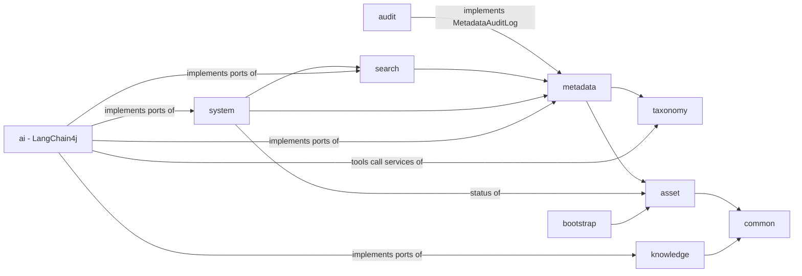

# Architecture and design decisions

This document explains *why* the DAM Metadata Agent is built the way it is. The README describes *what* it
does and how to run it.

The guiding rule:

> **Agents reason. Spring services execute. The domain remains authoritative.**

Language models are used only where probabilistic reasoning adds value: interpreting unstructured evidence,
writing descriptive text, choosing between taxonomy candidates, judging soft quality criteria and interpreting
natural-language queries. Everything that can be decided deterministically - CRUD, validation, approval rules,
authorization, transactions, date arithmetic, search execution, merging, auditing - is plain Java.

---

## 1. Context and scope

* The enterprise DAM owns the binaries. This service owns **metadata about
  assets** and references each asset by `externalAssetId` and URL.
* Product data comes from a product information system (PIM); image understanding from a vision service. Both
  are external and accessed through ports (`ProductInformationClient`, `AssetAnalysisService`), as is the DAM
  (`DamClient`). The POC ships YAML-backed mock adapters.
* It is a proof of concept that is meant to be *production-shaped*: real persistence, migrations, transactions,
  audit, observability and failure handling, with deliberately simple authentication (see §16).

### Technology baseline

| | Version | Notes |
|---|---|---|
| Java | 21 (target) | records, sealed types, pattern matching, virtual threads |
| Spring Boot | 4.1.1 | Jackson 3 for the web layer, JDBC (`JdbcClient`), Flyway, Actuator |
| LangChain4j | 1.21.0 | `ChatModel`, AI Services, tools, structured outputs, RAG |
| LangChain4j Agentic | 1.21.0-beta31 | experimental API - isolated (see §7) |
| PostgreSQL + pgvector | 17 (`pgvector/pgvector:pg17`) | metadata (JSONB) and vectors in one database |
| springdoc-openapi | 3.1.1 | OpenAPI / Swagger UI |
| Testcontainers | 2.x | PostgreSQL + pgvector in integration tests |
| Web UI | React 19, TypeScript 6, Vite 8 | Tailwind CSS 4, shadcn/ui (Radix), TanStack Query 5, React Router 8, React Hook Form + Zod 4 (see §18) |
| UI tests | Vitest 5, React Testing Library, MSW 2 | jsdom; the API is mocked at the network boundary |

LangChain4j still depends on Jackson 2 while Spring Boot 4 uses Jackson 3; both coexist (different packages).
The pom pins the Jackson 2 BOM to the version LangChain4j 1.21 is built against. The LangChain4j Agentic API was
verified against the library sources of the exact version used rather than older examples.

---

## 2. Module structure and dependency rules



(Edges to `common` and transitive edges are omitted; the graph is acyclic.)

Every module is split into `domain` (framework-free Java), `application` (use cases, transactions, ports),
`infrastructure` (adapters) and `api` (REST controllers and DTOs). The rules:

* **Domain code has no Spring, JDBC, Jackson or LangChain4j imports.** `MetadataValidator`, `ApprovalPolicy`,
  `MetadataMergePolicy` and `CompletenessCalculator` are plain classes, unit-testable without a container.
* **Only `com.example.dam.ai` imports `dev.langchain4j`.** The application layer talks to AI exclusively through
  ports it owns: `MetadataEnrichmentWorkflow`, `SemanticQualityAnalyzer`, `SearchIntentInterpreter`,
  `TextEmbedder`, `KnowledgeBase` and `KnowledgeAssistant`.
* **Dependencies point one way.** Where a module needs a capability of a module that depends on it, it declares a
  port that the other module implements: `asset` declares `InitialMetadataImporter` (implemented by
  `MetadataService`), and `metadata` declares `MetadataAuditLog` (implemented by the `audit` module, whose events
  are metadata-domain facts in `metadata.domain.audit`).
* **Persistence entities never leave the infrastructure layer**; controllers map domain objects to DTO records.

---

## 3. Why Spring owns the application lifecycle

Spring Boot is the composition root. LangChain4j objects (models, agents, tools, the agentic workflow, the
embedding store) are created in `@Configuration` classes and `@Component`s, not through LangChain4j's own
wiring or static factories, because:

* **One lifecycle and one configuration model.** Model provider, thresholds, timeouts and feature flags are
  ordinary `@ConfigurationProperties` (`AiProperties`, `ConfidenceThresholdProperties`) with validation at
  startup, overridable by environment variables and profiles.
* **Transactions, security context, MDC and metrics are Spring concerns.** Tools invoked by an agent call normal
  Spring beans and therefore get the same transaction boundaries, validation and observability as a REST call.
* **Conditional assembly.** `@ConditionalOnAiEnabled` removes the entire AI layer with `ai.enabled=false`; the
  application still starts and runs as a deterministic metadata service. Services depend on AI ports through
  `ObjectProvider`, so a missing implementation is a supported state, not a startup failure.
* **Testability.** Integration tests replace the `ChatModel` bean with a scripted test double; no agent code
  changes.

LangChain4j's own Spring Boot starters were not used: they wire one model per vendor through properties, while
this application needs explicit, validated, vendor-neutral model selection (`ChatModelConfiguration`) and a
graceful "AI unavailable" mode (`UnavailableChatModel` + an `ai` health component reporting `UNKNOWN` with the
reason) when the selected provider is misconfigured.

---

## 4. Why LangChain4j is isolated in the AI layer

* **The domain must be usable without AI.** Registration, CRUD, validation, approval, audit and structured search
  never touch LangChain4j. `AiDisabledIT` proves the application works with the AI layer switched off.
* **Framework churn is contained.** LangChain4j evolves quickly, and the agentic module is explicitly
  experimental. Ports defined in application terms (`MetadataEnrichmentResult`, `MetadataCandidate`,
  `InterpretedSearchIntent`, ...) mean an API change touches one package.
* **Vendor neutrality.** Agents are written against `ChatModel`; OpenAI, Anthropic, Ollama and the offline demo
  model are interchangeable by configuration (`ai.provider`). No vendor types leak out of `ai.config`.
* **Clear trust boundary.** Everything that crosses from `ai` into `application` is untrusted model output and
  passes through an anti-corruption layer (§9) and the deterministic approval policy.

---

## 5. Why deterministic validation instead of LLM validation

Whether a required field is present, a date is in the past, a value is in a controlled vocabulary or a URL is
well-formed are **facts**, computable exactly, cheaply and reproducibly in Java. Asking a model would add cost,
latency, non-determinism and a failure mode (hallucinated "valid") without any benefit. Therefore:

* `MetadataValidator` covers missing required fields, data types, vocabularies, patterns, lengths, ranges,
  repeatability, duplicates, URLs, taxonomy-path existence, date ranges, rights expiry and conditional
  requirements (e.g. `intendedForABTest=true` requires `experimentIdentifier`).
* Completeness and the 0-100 quality score are computed in Java (`CompletenessCalculator`, `QualityScoreCalculator`).
* The **schema is configuration** (`dam-metadata-schema.yaml`, synchronised into the database at startup and
  validated for consistency - e.g. `autoApply` together with `humanApprovalRequired` is rejected), so governance
  changes need no code changes.
* The `MetadataQualityAgent` receives the deterministic findings as input and is instructed not to repeat them; it
  only judges what Java cannot: weak descriptions, poor alt text, irrelevant keywords, ambiguous classification,
  inconsistent semantics. Its suggestions are reported separately (`aiSuggestions`) and never change the score.

The same principle applies to search: the `SearchIntentAgent` only *interprets* a query; `SearchIntentTranslator`
validates fields and vocabularies, computes dates ("within 30 days" becomes a `LocalDate` in Java) and drops
anything invalid with a warning; the SQL is executed deterministically.

---

## 6. Why AI produces proposals instead of updating metadata

AI output is probabilistic and not accountable; DAM metadata drives rights decisions, product pages and
publishing. So:

* **Agents have no write path.** The workflow returns a `MetadataEnrichmentResult` (candidates, planned routes,
  trace). All tools are read-only; there is no tool that writes, deletes or approves.
* **Every candidate becomes a `MetadataProposal`** with value, confidence, explanation, evidence, source
  (`AI_GENERATED`), model and workflow run id. Even auto-applied values keep their proposal record.
* **Authority is explicit.** Stored values carry `status` (`APPROVED` = authoritative: human-confirmed or from a
  system of record; `VALIDATED` = machine-applied after validation) and `source`. AI never replaces an
  `APPROVED` value (`ApprovalPolicy` rule 4); it may only *extend* lists after human review.
* **The decision is made at commit time, not by the workflow.** The workflow plans routes for its trace, but
  `EnrichmentResultRecorder` re-evaluates every candidate inside one transaction with the asset row locked
  (`SELECT ... FOR UPDATE`), against the *current* metadata. Concurrent manual edits during a long LLM call
  therefore cannot be overwritten. A policy-rejected candidate never supersedes an open proposal; at most one
  open proposal exists per asset and field (partial unique index).
* **Low-confidence suggestions are kept but never applied**, so reviewers can still see them.

---

## 7. Why the agentic workflow is wrapped behind `MetadataEnrichmentWorkflow`

```java
public interface MetadataEnrichmentWorkflow {
    MetadataEnrichmentResult enrich(UUID assetId);
}
```

`MetadataEnrichmentService` (application layer) depends on this port only; `AgenticMetadataEnrichmentWorkflow`
in `ai.workflow` is the single class that composes LangChain4j Agentic primitives. Reasons:

* **The agentic API is beta** (`1.21.0-beta31`). Its surface (builders, listener and scope semantics) is still
  evolving between releases; the blast radius of an upgrade is one package.
* **The orchestration is testable through the port** with any `ChatModel`, and replaceable (e.g. by a durable
  workflow engine) without touching callers.
* **Domain types in, domain types out.** No `AgenticScope`, `UntypedAgent` or `ResultWithAgenticScope` crosses the
  boundary.

### How the workflow uses LangChain4j Agentic

* **Sequential** composition for the pipeline, **parallel** execution of taxonomy classification and enrichment
  (on an MDC-propagating virtual-thread executor), **conditional** branches (taxonomy only for classifiable assets
  without an approved path; quality review only when there is something to review; routing by approval route).
* **Shared state** in the `AgenticScope` through typed keys (`EnrichmentState.Context`, `.Extraction`,
  `.Taxonomy`, `.Enrichment`, `.Candidates`, `.QualityReview`, `.Plan`) plus string keys carrying the JSON
  renderings used in prompt templates.
* **Deterministic steps are agents too.** Loading context, merging, consolidating and the approval decision are
  plain Java `@Agent` methods in the same agentic system, so they share the scope, appear in the trace and are
  observed by the same listener - without any LLM call.
* **A supervisor/orchestrator** at the root: the typed `MetadataSupervisorAgent` owns the listener, the error
  policy, the `beforeCall` initialisation (trace, correlation id) and assembles the typed result.

**Deterministic orchestrator rather than an LLM-planned supervisor.** LangChain4j also offers a
`supervisorBuilder()` in which a model decides which agent to call next. For a governed metadata pipeline the
order of steps is known in advance and must be reproducible and auditable, so the plan is fixed in code; the
models reason *inside* the steps. An LLM supervisor would be appropriate for open-ended tasks (e.g. a
conversational assistant for metadata stewards) and could be added behind the same port.

### Framework quirks handled (1.21.0-beta31)

Found while running the workflow and verified against the library sources; each is documented at the code site:

1. An inherited `AgentListener` reaches non-AI (POJO) agents only through a parent workflow. The pipeline is
   therefore nested as an untyped sequence below the typed supervisor, which carries the listener.
2. Conditional branches whose conditions match at the same time run in parallel on the framework's default
   executor, which does not propagate the MDC. The observability listener reads asset id, run id and correlation
   id from the scope first and falls back to the MDC.
3. Invoking an agentic agent outside an agentic system logs an "improper invocation" warning. Standalone uses
   (quality report, search interpretation) build the same interfaces and prompts as classic AI Services.
4. The root `errorHandler` applies to all nested agents. `WorkflowErrorHandler` retries an AI agent once on
   malformed output (`OutputParsingException` / JSON errors), then substitutes an empty fallback so the run
   continues without that agent's contribution and records a warning. Failures of deterministic steps abort.

---

## 8. Why tools delegate to Spring services

The `@Tool` classes (`AssetTools`, `MetadataTools`, `TaxonomyTools`, `ProductTools`, `MetadataKnowledgeTools`)
are thin adapters: they translate arguments, call an application service and return a compact view record.

* **No business logic in tools.** The rules live once, in the services, and are shared with REST and tests.
  Taxonomy search used by the agent is exactly the search behind `GET /api/taxonomy/search`.
* **Least privilege.** Tools are read-only and each agent receives only the tools it needs (extraction:
  product information; taxonomy: taxonomy search; enrichment: documentation and similar assets; quality:
  documentation, metadata and schema). Nothing can delete assets, change rights or approve proposals.
* **Robustness.** Tool failures, invalid arguments and hallucinated tool names are returned to the model as
  text ("the tool failed - continue without this information and lower your confidence") instead of failing
  the run; calls are capped per agent (`ai.workflow.max-tool-invocations`) and metered.
* **Context is preloaded where it is certain to be needed.** The workflow loads asset, metadata, schema, DAM
  EXIF/XMP, product data, vision results and the taxonomy candidates deterministically, so the model spends
  tool calls only on genuinely optional lookups. This is cheaper, faster and more reproducible than letting
  the model discover obvious context.

---

## 9. Why structured outputs are preferred

Each agent returns a Java record (`ExtractionOutput`, `EnrichmentOutput`, `TaxonomyClassification`,
`QualityReviewOutput`, `SearchIntentOutput`, `KnowledgeAnswerOutput`). With `ai.chat.json-schema=true` providers
that support JSON-schema structured outputs are constrained to the schema; others receive the format
instructions generated by LangChain4j.

* No regex parsing of free text; malformed output is a typed exception that the error policy can handle.
* Every suggestion has the same shape: `field`, `values`, `confidence`, `explanation`, `evidence`.
* Structure is **necessary but not sufficient**. `CandidateConsolidator` is the anti-corruption layer between
  untrusted model output and the domain: it discards unknown fields and placeholder values (`UNKNOWN`, `N/A`),
  parses values into typed `MetadataValue`s using the schema (canonicalising vocabulary values), clamps
  confidence, sanitises text, keeps the most confident duplicate and - critically - **resolves taxonomy paths
  from the repository**, rejecting nodes the model invented.

---

## 10. Why RAG for governance knowledge

Metadata governance (field meanings, mandatory fields per asset type, naming conventions, rights rules, alt-text
and photography guidelines, examples) changes more often than code and is written by metadata stewards, not
developers.

* Knowledge lives as Markdown in `src/main/resources/knowledge`, is split by section (`MarkdownSectionSplitter`
  keeps headings as context), embedded and stored in pgvector. Ingestion is idempotent (content hash + embedding
  model) and its failures never prevent startup.
* Agents receive the **relevant** rules instead of one giant prompt: the workflow retrieves guidance for the asset
  type into the agent context, and agents can query `searchMetadataDocumentation` for specifics. Prompts stay
  short and focused on role, constraints and output format.
* The `MetadataKnowledgeAssistant` answers steward questions with sources, and answers `UNKNOWN` when the
  retrieved documentation does not cover the question.
* Retrieval quality is tested (`KnowledgeRetrievalIT`): the mandatory-field question must retrieve the governance
  section that lists the PRODUCT_IMAGE requirements.

The *authoritative* schema is still the YAML configuration enforced in Java; RAG documents explain it to the
models and to people, they do not replace it.

---

## 11. Why human approval exists

Some metadata has legal, commercial or structural consequences: usage rights, copyright ownership, product
association, taxonomy placement, experiment identifiers. A wrong value can cause rights violations or mis-listed
products, and confidence scores of language models are not calibrated probabilities.

* **The schema decides, not the confidence.** `humanApprovalRequired` always wins; `enrichable: false` means AI
  may not even propose (rights dates, product id). The thresholds (`auto-approve: 0.92`, `human-review: 0.70`)
  only differentiate among fields the schema allows to be automated (`autoApply`, e.g. keywords, tags,
  description).
* **Approvals are durable work items, not suspended agents.** LangChain4j Agentic offers a human-in-the-loop
  agent that blocks a running workflow waiting for input. Reviews can take days, involve different people and
  must survive restarts, so each decision point is persisted as a `MetadataProposal` with its own REST lifecycle
  (`/api/metadata/proposals`). The workflow ends after planning; nothing waits in memory.
* **Approval is re-validated and stale-checked.** On approval the value is validated against the current schema,
  and if the field changed after the proposal was created the approval fails with `409 STALE_PROPOSAL`.
  Decisions are optimistically guarded so a proposal cannot be decided twice.
* **Approvers must be identified humans.** Actor ids starting with `ai:` or `system:` are reserved and can never
  approve or reject; rejections require a reason.
* **Everything is audited** (§12) and approved values are written back to the DAM after commit.

---

## 12. Audit and provenance

`metadata_audit_events` is append-only (no foreign keys, so history survives asset removal). Each event records
action, field, previous and new value, source, AI model, confidence, actor, approver, proposal id, reason,
correlation id and timestamp. `MetadataWriter` is the single write path for metadata values and proposal
decisions: it appends the audit event (through the `MetadataAuditLog` port, which requires an active transaction)
in the same transaction as the change, so no change can bypass the audit trail. Every stored value additionally
carries its own provenance (`source`, `status`, `confidence`, `aiModel`, `updatedBy`).

---

## 13. Persistence: JDBC, JSONB and pgvector

* **Spring JDBC (`JdbcClient`) instead of JPA.** The model is small but the queries are not ORM-shaped: typed
  values in JSONB, partial unique indexes, row locks, and hybrid search combining JSONB predicates with pgvector
  distance in **one** SQL statement. Explicit SQL keeps this visible and avoids entity leakage.
* **One row per asset and field** (`asset_metadata`) with the value as JSONB plus provenance columns. This keeps
  per-field provenance, approval and audit natural, while the schema - not the table layout - defines fields.
* **Flyway owns the schema** (no Hibernate DDL). The vector dimension is a Flyway placeholder bound to
  `ai.embedding.dimension`; `EmbeddingDimensionVerifier` fails fast if the configured embedding model does not
  match the database.
* **Two vector stores, two shapes.** Knowledge chunks use LangChain4j's `PgVectorEmbeddingStore` (standard RAG,
  table created by Flyway). Asset embeddings use a dedicated `asset_embeddings` table because hybrid search
  needs to join and filter against `assets` and `asset_metadata` in SQL, which a generic embedding-store API
  cannot express efficiently.
* **Indexing is eventually consistent.** Embeddings are rebuilt after commit (`@TransactionalEventListener`,
  asynchronous), from a deterministic text built from the asset type and the schema's `semanticSearch` fields. A
  scheduled job repairs missing or stale embeddings, so a temporarily unavailable embedding model never loses
  updates.

---

## 14. Resilience

AI is an enhancement, never a dependency of core DAM functionality:

| Failure | Behaviour |
|---|---|
| Provider misconfigured / unreachable | App starts; AI endpoints return `503` problem details; health shows the `ai` component |
| Timeout | Workflow bounded by `ai.workflow.timeout`; per-call timeouts and retries on the model client |
| Malformed model output | One retry, then the agent's contribution is skipped with a warning |
| One agent fails | Run continues with the other agents (`degraded`); `503` only if *every* AI agent failed |
| Tool failure | Reported to the model as text; counted in metrics |
| Embedding / pgvector failure | Structured search still runs (`degraded: true` with a warning); re-index job repairs later |
| NL interpretation unavailable | Falls back to semantic ranking of the raw query, or structured-only search |
| DAM write-back failure | Logged; local metadata stays authoritative (see §16 for the production approach) |

Errors are RFC 9457 problem details with a stable `code` and the `correlationId`.

---

## 15. Observability

* A correlation id per request (`X-Correlation-Id`, generated if absent) plus workflow run id and asset id are in
  the MDC, every log line, the audit events and the workflow trace.
* `AgentObservabilityListener` (an inherited LangChain4j Agentic listener) and `AiCallObserver` (standalone AI
  services) record agent name, kind (AI or deterministic), outcome, duration, model, token usage and tool calls.
  `ChatModelMetricsListener` meters every model call and token usage per model.
* Micrometer meters: `dam.ai.agent.invocations`, `dam.ai.tool.calls`, `dam.ai.tool.errors`, `dam.ai.model.calls`,
  `dam.ai.model.tokens`, `dam.ai.workflow.duration`, `dam.metadata.proposals`, `dam.metadata.approval.decisions`,
  `dam.search.indexing`.
* The enrichment response includes the per-step trace, so a reviewer can see which agent produced what; tracked
  runs expose the same per-stage data live (`/api/workflows/{id}`, see §18).
* Prompts, model responses, tool arguments and API keys are not logged (`ai.chat.log-requests/responses=false`).

---

## 16. Security and guardrails

* **Prompt injection:** all asset data, documents, queries and tool results are wrapped in tagged sections and
  the shared rules instruct every agent to treat them as untrusted data. More importantly, the architecture does
  not depend on the model obeying: tools are read-only, output is schema-validated and filtered, and the approval
  policy is enforced in Java after the model has finished.
* **Never invent values:** shared prompt rules require evidence for every value and `UNKNOWN`/no proposal when
  evidence is insufficient; placeholders are discarded by the consolidator; product associations and rights are
  not AI-enrichable; taxonomy must come from the repository.
* **Secrets** come only from environment variables (`.env.example` documents them; `.env` is git-ignored).
* **Authentication** is a stand-in: the `X-User-Id` header is resolved into an `Actor`. In production this would
  be an OIDC resource server with roles (e.g. `metadata-steward` for approvals, `rights-manager` for rights
  fields), using the same `Actor` abstraction.

---

## 17. The offline demo model

Running the POC should not require an API key, and tests must not call paid models. `OfflineDemoChatModel`
implements LangChain4j's `ChatModel` with transparent rules: it reads the structured context from the prompt,
returns schema-conformant JSON for the requested response format and performs real tool calls (e.g.
`searchTaxonomy`, `searchMetadataDocumentation`). The entire stack - prompts, AI Services, tools, agentic scope,
conditional routing, listeners, metrics, consolidation and policy - runs unchanged; only the reasoning is
simulated. It is clearly labelled (`aiModel: demo:offline-demo-rules-v1`) and selected by `ai.provider=demo`.

Integration tests use `ScriptedChatModel`, which can return scripted outputs or failures per agent (to test
low confidence, invented taxonomy, malformed output and outages) and otherwise delegates to the demo model.

---

## 18. Web UI and the APIs behind it

The web UI (`frontend/`) is a client of the same REST API as any other consumer. It added no business rules to
the browser; instead the backend gained a few read models and endpoints so the UI can *render* decisions.

### The backend decides, the UI renders

* Every proposal carries a `policy` computed by the domain (`ProposalReviewPolicy`): `requiresHumanApproval`,
  `canAutoApprove`, `bulkApprovable`, `riskLevel` and `riskFactors`. Risk is `HIGH` when the schema requires human
  approval or the field is not AI-enrichable, `MEDIUM` when an existing value would be replaced or confidence is
  below the review threshold, otherwise `LOW`; bulk approval needs an open, auto-approvable, low-risk proposal.
  The UI never infers safety from field names, confidence or schema flags, and `BulkApprovalService` re-checks the
  policy server-side, so a modified client cannot bulk-approve a sensitive field.
* Field definitions, their editor groups (`group` in the YAML schema, version 2), allowed values, validation rules,
  completeness, quality scores and the confidence thresholds (`/api/system/status`) come from the API. The UI's Zod
  rules are derived from the same field definition and only give immediate feedback; the server validates again.
* **Edit and approve:** a reviewer's edited value is applied as `MANUAL`/`APPROVED` by the reviewer, the proposal
  stores the `applied_value`, and the metadata entry's `origin` links back to the AI proposal. `AI_GENERATED`
  therefore always means "this exact value was produced by AI" - which keeps audit and model evaluation honest -
  while the UI can still show that a value started as an AI suggestion.

### Catalog read model

The asset list filters and sorts by completeness, quality, missing required fields, AI status, rights status and
key metadata fields. Computing these per request from JSONB metadata, proposals and runs would mean N+1 queries
and no index support, so `asset_metadata_summaries` is maintained in the same transaction as every metadata change
(`AssetStatusService.refresh`), backfilled on startup and refreshed nightly (`dam.metadata.summary-refresh-cron`;
rights status depends on today's date). The catalog query (`JdbcAssetCatalogRepository`) is a single SQL statement
over the summaries, the latest workflow run and the configured key fields (`dam.catalog.key-fields`).

### Tracked enrichment runs and live progress

* `POST /api/assets/{id}/enrich` stays synchronous for scripts and tests. With `Prefer: respond-async` (RFC 7240)
  it returns `202 Accepted` with `Location: /api/workflows/{runId}`, and the run executes on a bounded executor
  (`dam.enrichment.max-concurrent-runs`; further runs wait as `QUEUED`).
* Stage definitions come from the workflow port (`MetadataEnrichmentWorkflow.stages()`), so the plan the UI shows
  is the one the code runs. Status changes come from the LangChain4j Agentic `AgentListener`
  (`beforeAgentInvocation` marks a stage running; completion adds duration, tokens and tool calls) and from the
  `WorkflowTrace` sink for deterministic steps; retries are visible as attempts.
* `EnrichmentRunTracker` keeps live runs in memory and persists every transition to `enrichment_runs`. Subscribers
  receive **full snapshots** rather than deltas: a late subscriber starts from the current state, order is trivially
  safe and no replay is needed. Runs left `RUNNING` by a crash are marked failed on startup
  (`EnrichmentRunRecovery`).
* **Server-sent events** instead of WebSockets: progress is one-directional, SSE is plain HTTP that works through
  proxies, and `EventSource` reconnects by itself. The UI falls back to polling `GET /api/workflows/{id}` when the
  stream fails.
* Only safe information is exposed: stage status, timings, model, token counts, tool names, the agent's explanation
  and an outcome summary - never prompts, tool arguments or hidden reasoning.

### Previews, demo latency and serving the UI

* The UI previews assets through the `assetUrl` the backend returns; binaries never pass through this service. The
  mock DAM serves generated SVG renditions under `/mock-dam/...` (base URL `dam.integration.mock-dam-base-url`), so
  the UI behaves exactly as it would against a real DAM's rendition URLs.
* The offline demo model waits `ai.demo.simulated-latency` (600 ms by default, 0 in tests) per call so that stage
  progress is observable in demos. It slows the fake model down; it does not fabricate progress.
* The default Maven build stays Java-only. The `frontend` profile builds the UI with a project-local Node and
  bundles it as static resources; `SpaWebConfiguration` answers client-side routes with `index.html` without
  masking API or actuator 404s. Serving `frontend/dist` from a CDN with a same-origin reverse proxy works as well.

### Frontend engineering choices

* Server state lives only in TanStack Query; there is no client-side store of business data. List filters,
  sorting, paging and the selected tab live in the URL, so views are shareable and the back button works.
* DTO types are written by hand to mirror the OpenAPI schemas; generating them from `/v3/api-docs` in CI is the
  production step to detect drift.
* Plain semantic tables instead of a table library: sorting, filtering and paging are server-side, which keeps the
  bundle small and the markup accessible. Routes are lazy-loaded; Recharts is only loaded with the dashboard.
* Tests mock at the network boundary (MSW), so they exercise the real API client, query hooks and components; a
  fake `EventSource` drives the live workflow view (jsdom has none).

### Limitations

* Live progress is held per backend instance. With several instances, clients connected to another instance see
  persisted snapshots (polling works everywhere); production would publish run events through a shared channel
  (PostgreSQL `LISTEN/NOTIFY`, Redis or Kafka) or use sticky sessions.
* The reviewer identity is a header chosen in the UI (see §16); with OIDC the UI would obtain a token and the
  backend would derive the actor and roles from it.

---

## 19. Known limitations and next steps

* **Authentication/authorization:** replace the header-based actor with OIDC and field-level permissions.
* **DAM write-back:** currently best-effort after commit; production should use a transactional outbox with
  retries and idempotency keys, and conflict detection against the DAM's own versioning.
* **Real integrations:** replace the mock DAM, PIM and vision adapters (e.g. a vision-capable model or a
  dedicated image-analysis service behind `AssetAnalysisService`).
* **Evaluation:** add an offline evaluation set (golden assets with expected metadata) to measure precision of
  each agent per model and prompt version before changing thresholds; calibrate confidence per field.
* **Prompt and model versioning:** record prompt versions alongside the model on proposals and audit events.
* **Scale:** runs are asynchronous but execute in-process on a bounded executor; bulk ingestion needs a durable
  job queue with back-pressure, and live progress a shared event channel (§18). Tune the HNSW index parameters
  for the asset volume; batch embedding requests.
* **Multilingual metadata:** language-specific titles and alt text with the `language` field as a dimension.
